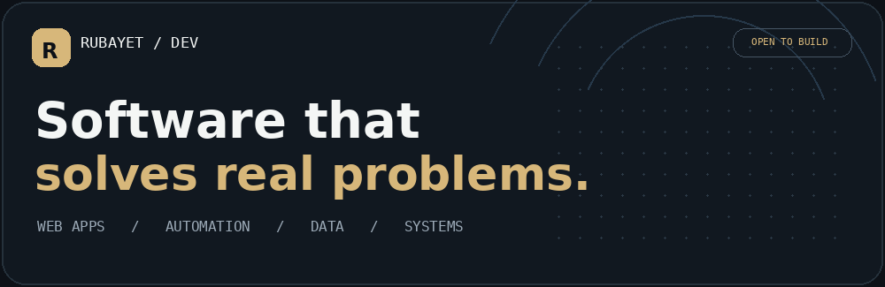
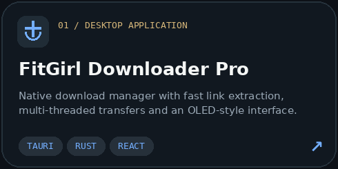
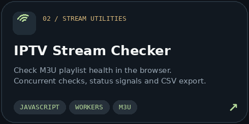
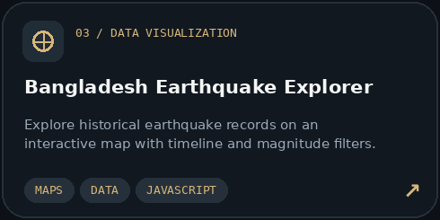
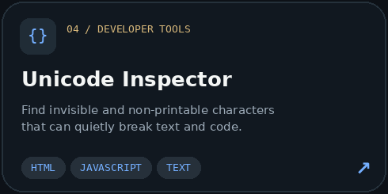
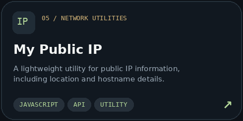
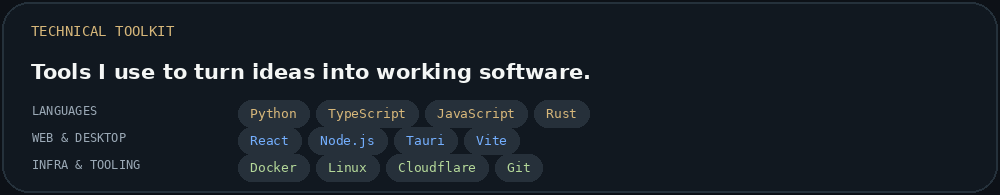
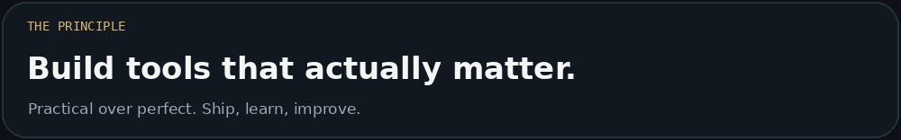

 

**Independent developer building practical tools for the web, desktop and beyond.**

 

<table>
<tr><td width="50%" valign="top">

### 01 — What I do

I design and build focused software that turns complex or repetitive tasks into simple, usable experiences.

**Main interests:** full-stack applications, desktop utilities, automation, data exploration and developer tooling.

</td><td width="50%" valign="top">

### 02 — How I work

**Useful before flashy.** I value thoughtful interfaces, maintainable code and software people can put to work immediately.

From quick experiments to finished products: build, test, improve and ship.

</td></tr>
</table>

### Selected work

<table>
<tr>
<td width="50%" valign="top"> <a href="https://github.com/Rubayet123/fitgirl-downloader-pro/releases/tag/fitgirl-repacks"><b>Release / Download</b></a></td>
<td width="50%" valign="top"> <a href="https://rubayet123.github.io/iptv-checker/"><b>Launch live demo</b></a></td>
</tr>
<tr>
<td width="50%" valign="top"> <a href="https://rubayet123.github.io/earthquake/"><b>Explore earthquake data</b></a></td>
<td width="50%" valign="top"> <a href="https://rubayet123.github.io/unicode-viewer/"><b>Open Unicode Inspector</b></a></td>
</tr>
<tr><td colspan="2" valign="top"> <a href="https://rubayet123.github.io/my-ip/"><b>Check your public IP</b></a></td></tr>
</table>

### Stack & tooling

### Open-source activity

Contribution graph is provided by a third-party service and may occasionally be unavailable.

 

MADE WITH CURIOSITY · BUILT FOR UTILITY

[Portfolio](https://rubayet123.github.io/) · [GitHub](https://github.com/Rubayet123) · [All repositories](https://github.com/Rubayet123?tab=repositories)

