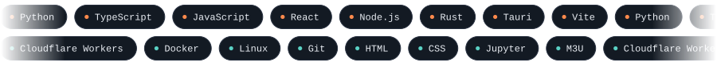
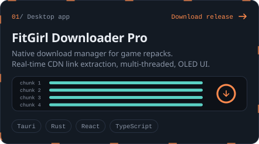
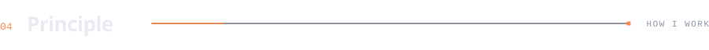

<picture>
  <source media="(prefers-color-scheme: dark)" srcset="./assets/header-dark.svg">
  <source media="(prefers-color-scheme: light)" srcset="./assets/header-light.svg">
  
</picture>

  Independent developer focused on practical software:
  <b>web apps</b>, <b>automation</b>, <b>servers</b> and <b>data systems</b>.

 

<picture>
  <source media="(prefers-color-scheme: dark)" srcset="./assets/section-build-dark.svg">
  <source media="(prefers-color-scheme: light)" srcset="./assets/section-build-light.svg">
  
</picture>

<picture>
  <source media="(prefers-color-scheme: dark)" srcset="./assets/capabilities-dark.svg">
  <source media="(prefers-color-scheme: light)" srcset="./assets/capabilities-light.svg">
  
</picture>

 

<picture>
  <source media="(prefers-color-scheme: dark)" srcset="./assets/section-stack-dark.svg">
  <source media="(prefers-color-scheme: light)" srcset="./assets/section-stack-light.svg">
  
</picture>

<picture>
  <source media="(prefers-color-scheme: dark)" srcset="./assets/stack-dark.svg">
  <source media="(prefers-color-scheme: light)" srcset="./assets/stack-light.svg">
  
</picture>

 

<picture>
  <source media="(prefers-color-scheme: dark)" srcset="./assets/section-work-dark.svg">
  <source media="(prefers-color-scheme: light)" srcset="./assets/section-work-light.svg">
  
</picture>

<a href="https://github.com/Rubayet123/fitgirl-downloader-pro/releases/tag/fitgirl-repacks"><picture>
  <source media="(prefers-color-scheme: dark)" srcset="./assets/card-fitgirl-dark.svg">
  <source media="(prefers-color-scheme: light)" srcset="./assets/card-fitgirl-light.svg">
  
</picture></a>
<a href="https://rubayet123.github.io/iptv-checker/"><picture>
  <source media="(prefers-color-scheme: dark)" srcset="./assets/card-iptv-dark.svg">
  <source media="(prefers-color-scheme: light)" srcset="./assets/card-iptv-light.svg">
  
</picture></a>

<a href="https://rubayet123.github.io/earthquake/"><picture>
  <source media="(prefers-color-scheme: dark)" srcset="./assets/card-quake-dark.svg">
  <source media="(prefers-color-scheme: light)" srcset="./assets/card-quake-light.svg">
  
</picture></a>
<a href="https://rubayet123.github.io/unicode-viewer/"><picture>
  <source media="(prefers-color-scheme: dark)" srcset="./assets/card-unicode-dark.svg">
  <source media="(prefers-color-scheme: light)" srcset="./assets/card-unicode-light.svg">
  
</picture></a>

<a href="https://rubayet123.github.io/my-ip/"><picture>
  <source media="(prefers-color-scheme: dark)" srcset="./assets/card-ip-dark.svg">
  <source media="(prefers-color-scheme: light)" srcset="./assets/card-ip-light.svg">
  
</picture></a>

 

<picture>
  <source media="(prefers-color-scheme: dark)" srcset="./assets/section-principle-dark.svg">
  <source media="(prefers-color-scheme: light)" srcset="./assets/section-principle-light.svg">
  
</picture>

<picture>
  <source media="(prefers-color-scheme: dark)" srcset="./assets/principle-dark.svg">
  <source media="(prefers-color-scheme: light)" srcset="./assets/principle-light.svg">
  
</picture>

 

<picture>
  <source media="(prefers-color-scheme: dark)" srcset="./assets/section-activity-dark.svg">
  <source media="(prefers-color-scheme: light)" srcset="./assets/section-activity-light.svg">
  
</picture>

<picture>
  <source media="(prefers-color-scheme: dark)" srcset="https://github-readme-activity-graph.vercel.app/graph?username=Rubayet123&bg_color=0d1117&color=8c97a9&line=ff8a4c&point=e8ecf2&area=true&area_color=ff8a4c&hide_border=true&hide_title=true">
  <source media="(prefers-color-scheme: light)" srcset="https://github-readme-activity-graph.vercel.app/graph?username=Rubayet123&bg_color=ffffff&color=5a6476&line=d9531e&point=14181f&area=true&area_color=d9531e&hide_border=true&hide_title=true">
  
</picture>

<picture>
  <source media="(prefers-color-scheme: dark)" srcset="https://streak-stats.demolab.com?user=Rubayet123&background=0d1117&border=273040&stroke=273040&ring=ff8a4c&fire=ff8a4c&currStreakNum=e8ecf2&sideNums=e8ecf2&currStreakLabel=ff8a4c&sideLabels=8c97a9&dates=8c97a9&hide_border=true&date_format=j%20M%5B%20Y%5D">
  <source media="(prefers-color-scheme: light)" srcset="https://streak-stats.demolab.com?user=Rubayet123&background=ffffff&border=dbe0e8&stroke=dbe0e8&ring=d9531e&fire=d9531e&currStreakNum=14181f&sideNums=14181f&currStreakLabel=d9531e&sideLabels=5a6476&dates=5a6476&hide_border=true&date_format=j%20M%5B%20Y%5D">
  
</picture>

 

<picture>
  <source media="(prefers-color-scheme: dark)" srcset="./assets/section-connect-dark.svg">
  <source media="(prefers-color-scheme: light)" srcset="./assets/section-connect-light.svg">
  
</picture>

<a href="https://rubayet123.github.io/"><picture>
  <source media="(prefers-color-scheme: dark)" srcset="./assets/btn-portfolio-dark.svg">
  <source media="(prefers-color-scheme: light)" srcset="./assets/btn-portfolio-light.svg">
  
</picture></a>
&nbsp;
<a href="https://github.com/Rubayet123"><picture>
  <source media="(prefers-color-scheme: dark)" srcset="./assets/btn-github-dark.svg">
  <source media="(prefers-color-scheme: light)" srcset="./assets/btn-github-light.svg">
  
</picture></a>

 

<picture>
  <source media="(prefers-color-scheme: dark)" srcset="./assets/footer-dark.svg">
  <source media="(prefers-color-scheme: light)" srcset="./assets/footer-light.svg">
  
</picture>
